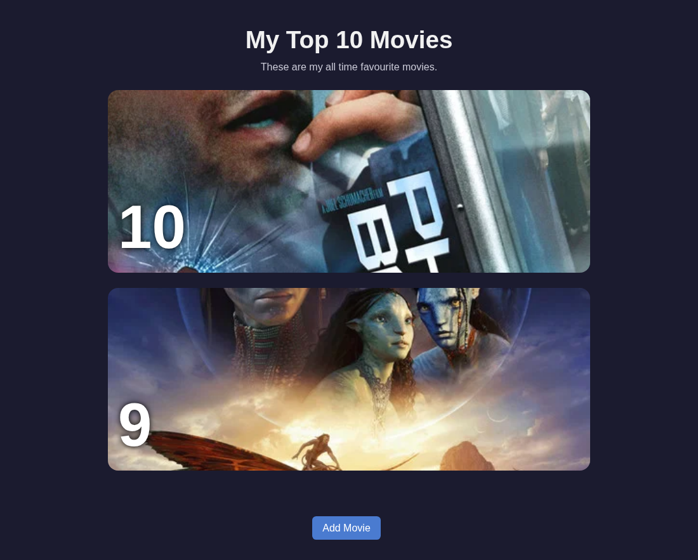
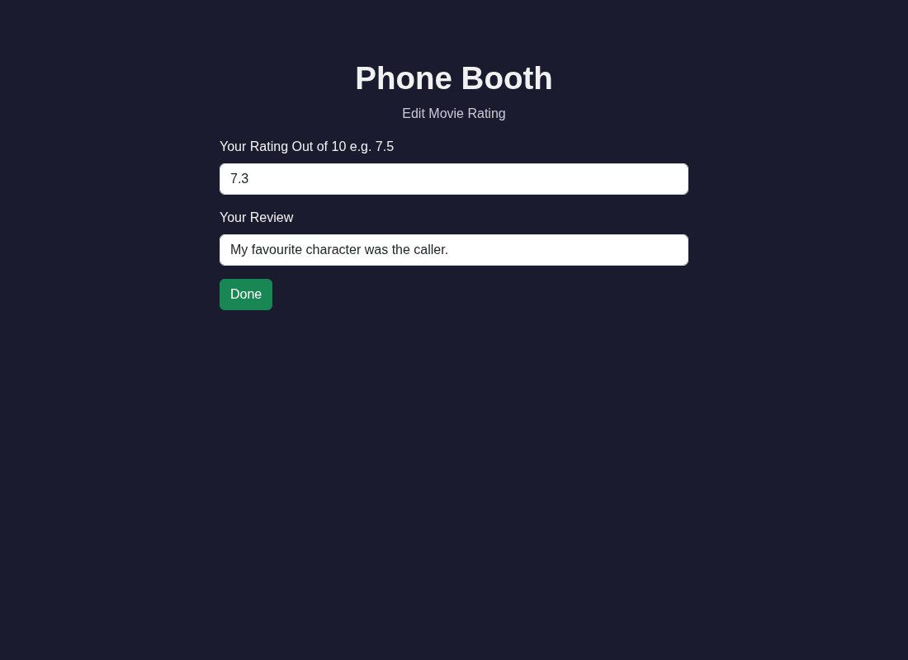
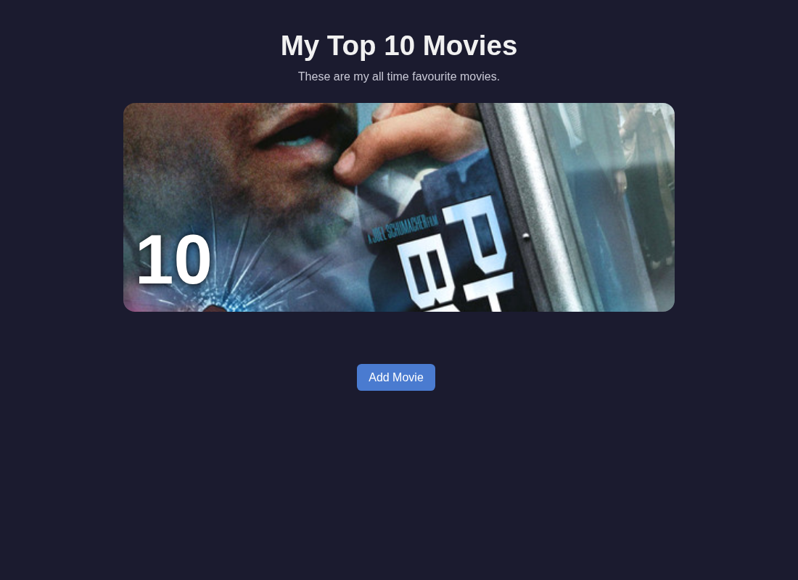

# 🚀 Top Movies

Day 64 of Udemy's "100 Days of Code": a Flask website that lists your favourite movies, lets you add them from The Movie Database (TMDB), rate and review them, delete them, and ranks them by rating. Written for fellow course participants and anyone browsing for a small Flask example.

## 📚 Table of Contents

- [Overview](#-overview)
- [Requirements](#-requirements)
- [Setup](#-setup)
- [Run](#-run)
- [Tests](#-tests)
- [License](#-license)
- [Links](#-links)
- [Appendix: Project documents](#-appendix-project-documents)

## 🧭 Overview

The project follows the five requirements of the lecture, one step at a time. Each step has a milestone, tests, a screenshot and a wiki page in English, Danish and Bahasa Malaysia.

| Folder | What it is for |
| --- | --- |
| `src/top_movies/` | The Flask application (`constants.py` holds the constants) |
| `tests/` | pytest tests; they need no network and no TMDB key |
| `docs/` | Project documents, screenshots (`docs/screenshots/`) and the wiki sources |
| `scripts/` | The local opengrep scan |
| `tools/screenshots/` | Docker tool that captures the screenshots without using your desktop |

Source code carries Doxygen comments; build the reference with `doxygen Doxyfile` (output in `docs/doxygen/`, not committed).

## 📋 Requirements

- Python 3.13 or later, with the built-in `venv` module.
- Runtime packages, installed by `pip` from `pyproject.toml`. Each is needed by the assignment: Flask (web framework), Flask-SQLAlchemy (SQLite database), Flask-WTF (forms), Bootstrap-Flask (page styling and form rendering) and requests (TMDB calls). There are no other runtime dependencies.
- For the Add Movie page: a free TMDB API key in the environment variable `TMDB_API_KEY`. The tests do not need it.
- Optional tools: Doxygen (reference), Docker (screenshots) and opengrep (security scan).

## 🛠️ Setup

Create a local virtual environment in `.venv`, upgrade pip and install the project with the test tools.

Windows (PowerShell):

```powershell
python -m venv .venv
.\.venv\Scripts\Activate.ps1
python -m pip install --upgrade pip
python -m pip install -e ".[dev]"
```

macOS and Linux:

```bash
python3 -m venv .venv
source .venv/bin/activate
python -m pip install --upgrade pip
python -m pip install -e ".[dev]"
```

Leave the environment with `deactivate`. Delete `.venv` to start over.

## ▶️ Run

Activate the `.venv`, set the optional keys and start the server:

```bash
export TMDB_API_KEY=your-key-here   # PowerShell: $env:TMDB_API_KEY = "your-key-here"
python -m flask --app top_movies run
```

Open <http://127.0.0.1:5000/>. The SQLite database `movies.db` is created in the Flask instance folder (`src/instance/` when you run from source). Load the two example movies of the lecture with `python -m flask --app top_movies seed` (safe to run twice).

### 🎞️ Lecture steps

| Step | What it adds | Screenshot |
| --- | --- | --- |
| Requirement 1 | The home page lists the movies stored in SQLite |  |
| Requirement 2 | The Update button opens a WTForms form to change the rating and review |  |
| Requirement 3 | The Delete button removes a movie (screenshot: the home page after deleting Avatar) |  |

## 🧪 Tests

```bash
python -m pytest
```

Before every push run the local security scan (opengrep, rules in `scripts/opengrep-rules.yml`):

```bash
bash scripts/scan.sh          # PowerShell: .\scripts\scan.ps1
```

Screenshots are captured in a Docker container so your mouse and keyboard stay free:

```bash
bash tools/screenshots/run.sh r1-home=/
```

## 📄 License

GNU Affero General Public License v3.0, see [LICENSE](./LICENSE).

## 🔗 Links

- [Repository][repository]
- [Documentation][documentation]
- [Issue tracker][issues]

## 📎 Appendix: Project documents

| Document | What it tells you |
| --- | --- |
| [AGENTS.md][agents] | The rules AI agents follow in this repository |
| [Business Case][BC-001] | Why the project exists, its scope and success criteria |
| [Stakeholder Analysis][SA-001] | Who is involved; the stakeholder IDs used for owners and reviewers |
| [Project Plan][PP-001] | The gateways and their schedule |
| [Milestones][milestones] | One document per gateway: Go/No-Go criteria and tasks |
| [Artifact registry][registry] | Where each artifact type lives, the next version, the PO language and domain |
| [Traceability matrix][TM-001] | How the artifacts link and when each was last reviewed |
| [Framework README][framework-readme] | The framework this project uses |
| [Framework changelog][framework-changelog] | What changed in each framework release |

---

[repository]: https://git.tirsystem.com/Tirsvad-Udemy-100-days-of-code/064-top-movies
[documentation]: https://git.tirsystem.com/Tirsvad-Udemy-100-days-of-code/064-top-movies/wiki
[issues]: https://git.tirsystem.com/Tirsvad-Udemy-100-days-of-code/064-top-movies/issues
[agents]: ./AGENTS.md
[BC-001]: ./docs/business-case.md
[SA-001]: ./docs/stakeholder-analysis.md
[PP-001]: ./docs/project-plan.md
[milestones]: ./docs/milestones/
[registry]: ./docs/artifact-registry.md
[TM-001]: ./docs/sqa/traceability-matrix.md
[framework-readme]: ./framework/README.md
[framework-changelog]: ./framework/CHANGELOG.md
