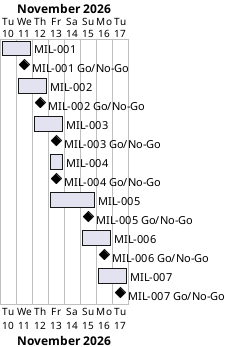

# Project Plan

## Metadata
| Key | Value |
| --- | --- |
| ID | PP-001 |
| CrossReference | [BC-001], [SA-001], [MIL-001], [MIL-002], [MIL-003], [MIL-004], [MIL-005], [MIL-006], [MIL-007] |
| Language | en |
| Domain | it |

## Version History
| Date | Status | Author | Reviewer | Change | Commit |
| --- | --- | --- | --- | --- | --- |
| 2026-11-10 | Accepted | Jens Tirsvad Nielsen | AI as stand-in for S01 | Initial version | [c015885] |

---

## Purpose

Schedule the seven phases that deliver the Day 64 "Top Movies" assignment, one pull request per phase, over the short timeline of a course assignment.

## Planning Assumptions

- Week 1 starts 2026-11-10; the plan ends by 2026-11-17. The Business Case sets no fixed deadline, so the dates are targets.
- Phase length: one to three days. The pace follows the chat-based communication of CM-001 in [SA-001].
- Phases run in autonomous mode: the AI is the stand-in reviewer for S01 and records each review as not independent.

## Gateway Schedule

| Gateway | Document | Window | Decision date | Owner | Stories | Main deliverable | Milestone |
| --- | --- | --- | --- | --- | --- | --- | --- |
| Foundation | [MIL-001] | to 2026-11-11 | 2026-11-11 | S01 | none | the project skeleton, tooling and repository metadata are ready for feature work | |
| Requirement 1: view the movie list | [MIL-002] | to 2026-11-12 | 2026-11-12 | S01 | none | the home page lists movies from the SQLite database as the assignment shows | |
| Requirement 2: edit rating and review | [MIL-003] | to 2026-11-13 | 2026-11-13 | S01 | none | a movie's rating and review can be changed through a WTForms form | |
| Requirement 3: delete movies | [MIL-004] | to 2026-11-13 | 2026-11-13 | S01 | none | a movie can be removed from the database from its card | |
| Requirement 4: add movies through TMDB | [MIL-005] | to 2026-11-15 | 2026-11-15 | S01 | none | a user can search TMDB by title, pick a result, store it and then rate it | |
| Requirement 5: sort and rank by rating | [MIL-006] | to 2026-11-16 | 2026-11-16 | S01 | none | the home page ranks movies by rating, best first, and keeps the ranking current | |
| Wiki, screenshots and release | [MIL-007] | to 2026-11-17 | 2026-11-17 | S01 | none | the documentation is complete in three languages and the project can be released | |



## Scope Coverage

| Business Case scope item | Gateway |
| --- | --- |
| Flask application, SQLite model and templates | [MIL-002] |
| Edit rating and review | [MIL-003] |
| Delete | [MIL-004] |
| TMDB search and add | [MIL-005] |
| Ranking | [MIL-006] |
| `pyproject.toml`, `.gitignore`, `constants.py`, Doxyfile, README, opengrep | [MIL-001] |
| Wiki in three languages and screenshots | [MIL-007] (screenshots are taken in MIL-002 to MIL-006) |
| Repository description and topics | [MIL-001] |

## Dependencies

```
MIL-001 -> MIL-002 -> MIL-003 -> MIL-005 -> MIL-006 -> MIL-007
                  \-> MIL-004
```

A No-Go on a phase moves every later date by the time the fix takes.

## Plan Risks

| Risk | Impact | Mitigation |
| --- | --- | --- |
| Docker image for screenshots is slow to build or unavailable | Screenshots delay MIL-002 | Build once in MIL-001 and reuse; if it fails, stop and report |
| Pull request checks on the host are absent or slow | Merge waits | Run pytest and opengrep locally before each push |
| TMDB API key missing | Live add flow cannot be shown | Test double; document the variable |

## Open Issues

- Use cases and user stories are not modelled: every task is marked as a plain task (`No`) because the assignment is a short, fully specified exercise. S01 may ask for them at plan acceptance.
- The repository URL in the request (`Tirsvad-Udemy-100_days_of_code`) differs from the configured remote (`Tirsvad-Udemy-100-days-of-code/064-top-movies`); the configured remote is used.
- The Udemy starter archives are not downloaded; templates are re-created from the lecture description.
- No `.gitea` publish workflow is installed, so milestones are published with `sync-project.sh --apply` as part of the accepted plan.

---

[BC-001]: ./business-case.md
[SA-001]: ./stakeholder-analysis.md
[MIL-001]: ./milestones/mil-001-foundation.md
[MIL-002]: ./milestones/mil-002-view-movies.md
[MIL-003]: ./milestones/mil-003-edit-movie.md
[MIL-004]: ./milestones/mil-004-delete-movie.md
[MIL-005]: ./milestones/mil-005-add-movie-tmdb.md
[MIL-006]: ./milestones/mil-006-rank-movies.md
[MIL-007]: ./milestones/mil-007-wiki.md
[c015885]: https://git.tirsystem.com/Tirsvad-Udemy-100-days-of-code/064-top-movies/commit/c015885544ba82f59729d068bc55c5d2a1f2bb7c
